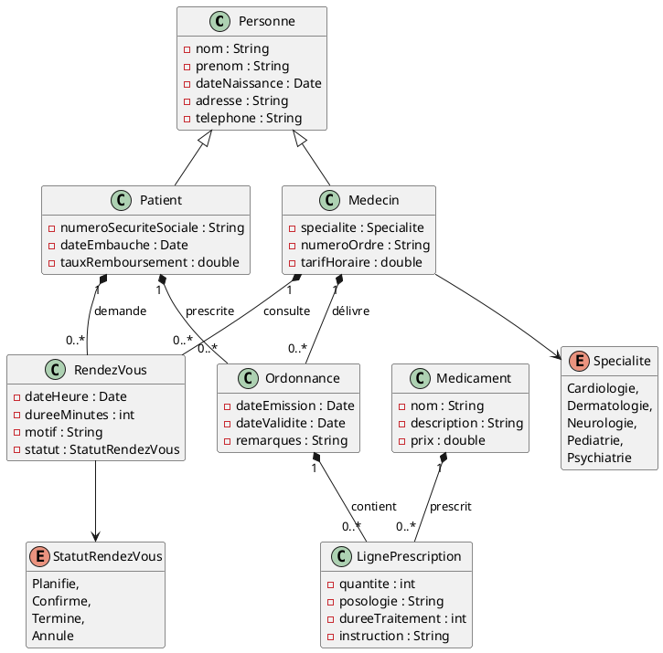

# Application de gestion d'un cabinet médical

## Description du projet et des fonctionnalités implémentées

**À COMPLÉTER**

## Membres du groupe

Lucille Coquerelle 
Nathan Miont
Ethan Lagaisse-Brodowski
Youssef Pirmiet

## Répartition du travail

**TABLEAU À COMPLÉTER**

| Membre du groupe   | Tâches réalisées                                                              | Ticket associé |
|--------------------|-------------------------------------------------------------------------------|----------------|
| Youssef Pirmiet    | configuration initial pour les loggers                                        | #2             |
| Youssef Pirmiet    | configuration initial pour les loggers                                        | #3             |
| Youssef Pirmiet    | Modification de la méthode stat pour s'adapter aux logger                     | #4             |
| Lucille Coquerelle | modification de la classe Statistiques                                        | #4             |
| Ethan Lagaisse-Bro | modification de la classe Recherche                                           | #5             |
| Youssef Pirmiet    | adaptation de la classe recherche et de la classe main aux logger             | #5             |
| Ethan Lagaisse-Bro | Ticket 6, modification du fichier build.gradle pour utiliser JUnit5, JUnit... | #6             |
| Nathan Miont       | creation de la methode getPrixTotal() dans la classe Ordonnance               | #9             |
| Nathan Miont       | creation de la méthode getPrixTotal() dans la classe RendezVous               | #10            |
| Nathan Miont       | Ajoute de la javaDoc dans la classe Ordonnance                                | #8             |
| Lucille Coquerelle | faire les tests unitaires de la classe ordonnance                             | #11            |
| Ethan Lagaisse-Bro | Test unitaire de la classe patient.                                           | #13            |
| Nathan Miont       | faire les tests sur la classe medecins                                        | #14            |
| Lucille Coquerelle | faire des test Ordonnances                                                    | #12            |
| Youssef Pirmiet    | ajout des tests de GestionRendezVous                                          | #21            |
| Nathan Miont       | creation de la classe TestGestionMédicament                                   | #15            |
| Lucille Coquerelle | Ajoute de la javaDoc dans la classe Medecin                                   | #8             |
| Lucille Coquerelle | Remplacer les List par des ObservableList                                     | #31            |
| Youssef Pirmiet    | ajout du TestGestionPatients                                                  | #7             |
| Nathan Miont       | Remplacer les List par des ObservableList                                     | #31            |
| Lucille Coquerelle | faire la vue                                                                  | #23            |
| Ethan Lagaisse-Bro | Modification de la classe recherche                                           | #5             |
| Ethan Lagaisse-Bro | Modification du build.gradle                                                  | #6             |
| Ethan Lagaisse-Bro | JavaDocs de patient                                                           | #8             |
| Ethan Lagaisse-Bro | Test unitaire pour patient                                                    | #13            |
| Youssef Pirmiet    | decoupage pour JavaFX                                                         | #32            |
| Nathan Miont       | README.md                                                                     | #33            |
| Lucille Coquerelle | Ajout des attributs FXML                                                      | #23            |
| Youssef Pirmiet    | Decoupage MVC en JavaFX                                                       | #34            |
| Ethan Lagaisse-Bro | Creation du controller                                                        | #24            |

## Présentation du code de base

### Diagramme des classes du modèle

### Diagramme des classes "services"

```plantuml
@startuml

top to bottom direction


class GestionMedecins {
  - medecins: List<Medecin>
  + rechercherParSpecialite(Specialite): List<Medecin>
  + ajouterMedecin(Medecin): void
  + rechercherParId(int): Medecin
  + mettreAJourMedecin(int, String, String, double, String, String, Specialite): void
  + getNombreMedecins(): int
  + afficherTousLesMedecins(): void
  + rechercherParNumeroOrdre(String): Medecin
  + listerTousLesMedecins(): List<Medecin>
  + rechercherParNom(String): List<Medecin>
  + supprimerMedecin(int): boolean
}
class GestionMedicaments {
  - medicaments: List<Medicament>
  + rechercherParId(int): Medicament
  + supprimerMedicament(int): boolean
  + ajouterMedicament(Medicament): void
  + listerTousLesMedicaments(): List<Medicament>
  + afficherTousLesMedicaments(): void
  + rechercherParNom(String): List<Medicament>
  + getNombreMedicaments(): int
}
class GestionOrdonnances {
  - ordonnances: List<Ordonnance>
  + listerToutesLesOrdonnances(): List<Ordonnance>
  + ajouterPrescription(int, Medicament, int, String, int, String): void
  + creerOrdonnance(Medecin, Patient, LocalDate, String): Ordonnance
  + getOrdonnancesMedecin(Medecin): List<Ordonnance>
  + getOrdonnancesValides(): List<Ordonnance>
  + getOrdonnancesPatient(Patient): List<Ordonnance>
  + afficherToutesLesOrdonnances(): void
  + rechercherParId(int): Ordonnance
  + getNombreOrdonnances(): int
}
class GestionPatients {
  - patients: List<Patient>
  + rechercherParNumeroSecu(String): Patient
  + mettreAJourPatient(int, String, String, String, String, String, double): void
  + afficherTousLesPatients(): void
  + supprimerPatient(int): void
  + ajouterPatient(Patient): void
  + listerTousLesPatients(): List<Patient>
  + rechercherParId(int): Patient
  + getNombrePatients(): int
  + rechercherParNom(String): List<Patient>
}
class GestionRendezVous {
  - rendezVous: List<RendezVous>
  + prendreRendezVous(Patient, Medecin, LocalDateTime, int, String): RendezVous
  + confirmerRendezVous(int): void
  + getRendezVousParStatut(StatutRendezVous): List<RendezVous>
  + terminerRendezVous(int): boolean
  + getRendezVousPatient(Patient): List<RendezVous>
  + rechercherParId(int): RendezVous
  + annulerRendezVous(int): void
  + getRendezVousMedecin(Medecin): List<RendezVous>
  + estDisponible(Medecin, LocalDateTime): boolean
  + getNombreRendezVous(): int
  + afficherTousLesRendezVous(): void
  + listerTousLesRendezVous(): List<RendezVous>
}
class Main {
  + main(String[]): void
}


Main                -[#595959,dashed]->  GestionMedecins    : "«create»"
Main                -[#595959,dashed]->  GestionMedicaments : "«create»"
Main                -[#595959,dashed]->  GestionOrdonnances : "«create»"
Main                -[#595959,dashed]->  GestionPatients    : "«create»"
Main                -[#595959,dashed]->  GestionRendezVous  : "«create»"
@enduml
```

